<div align="center">

# VTLA

### Vision–Tactile–Language–Action for SO-101 + Paxini

시각·촉각·언어를 함께 이해해 로봇 행동을 생성하는 **pi0.5 기반 멀티모달 로봇 학습 스택**

[](https://www.python.org/)
[](https://github.com/huggingface/lerobot)
[](https://huggingface.co/lerobot/pi05_base)
[](#tactile-hardware)
[](./LICENSE)
[](#project-status)

<br>

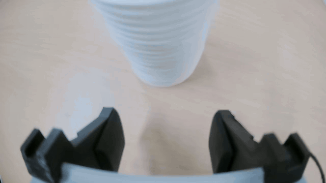

<sub>SO-101 wrist-camera view · “Pick one cup from the stacked cups and place it on the left side.”</sub>

</div>

---

## Overview

**VTLA**는 Hugging Face [LeRobot](https://github.com/huggingface/lerobot)을 기반으로, SO-101 로봇과 Paxini 촉각 센서를 pi0.5 Vision-Language-Action 정책에 연결한 연구용 프로젝트입니다.

기존의 `카메라 + 로봇 상태 + 언어 + 행동` 흐름에 `observation.tactile.primary`를 정식 입력으로 추가합니다. 촉각 신호는 RGB 이미지로 변환하지 않고 `float32` 공간 맵으로 보존하며, prefix token 또는 action-side gating 방식으로 정책에 주입할 수 있습니다.

> 저장소 이름은 **VTLA**지만, 기존 LeRobot 생태계 및 CLI 호환성을 위해 Python 패키지 이름과 명령어는 `lerobot`을 유지합니다.

### What this repository adds

| Area | VTLA extension |
| --- | --- |
| Robot | `paxini_so101_follower` wrapper와 Paxini UART reader |
| Tactile | 154 taxel을 `(2, 9, 9)` `float32` 맵으로 저장 |
| Policy | pi0.5 tactile prefix 및 action-gated injection |
| Cameras | macOS AVFoundation 및 원격 WebRTC 입력 |
| Training | A0 / A15 / A2 PEFT-LoRA 실험 하네스 |
| Evaluation | 로봇 실행 전 offline action comparison과 진단 그래프 |

## Demo

<table>
  <tr>
    <th width="50%">Wrist camera</th>
    <th width="50%">Paxini tactile response</th>
  </tr>
  <tr>
    <td></td>
    <td>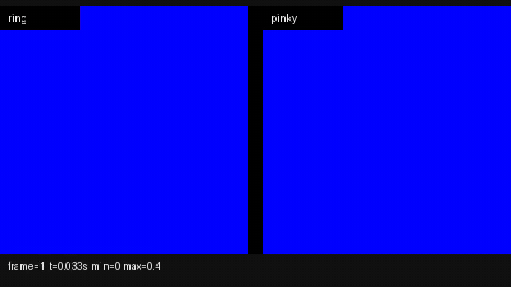</td>
  </tr>
  <tr>
    <td align="center"><code>observation.images.wrist</code></td>
    <td align="center">ring / pinky · 154 taxels</td>
  </tr>
</table>

### Three synchronized camera views

<table>
  <tr>
    <th>Top</th>
    <th>Wrist</th>
    <th>Belly</th>
  </tr>
  <tr>
    <td>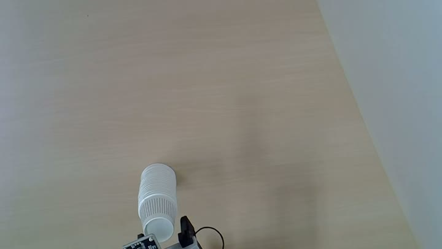</td>
    <td>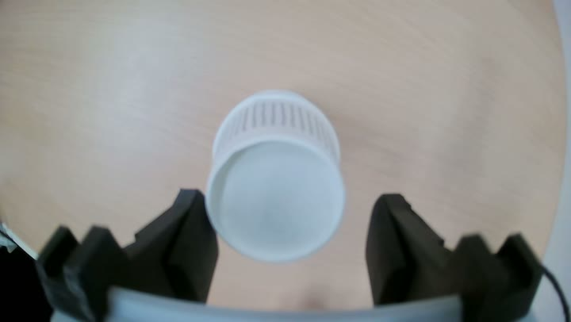</td>
    <td>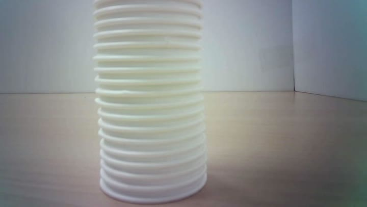</td>
  </tr>
</table>

## Tactile hardware

VTLA의 그리퍼에는 **Paxini GEN3 M3025 계열 분포형 촉각 센서 2개**를 장착했습니다. 두 센서는 gripper의 ring / pinky 쪽 접촉면에 배치되며, 센서당 77개씩 총 **154 taxel**의 접촉 신호를 수집합니다.

<table>
  <tr>
    <th width="62%">SO-101 + Paxini tactile gripper</th>
    <th width="38%">Custom sensor-mount CAD</th>
  </tr>
  <tr>
    <td>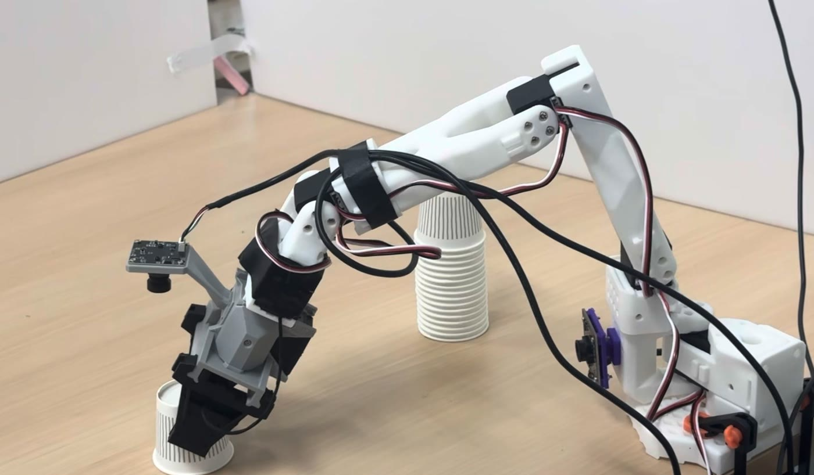</td>
    <td>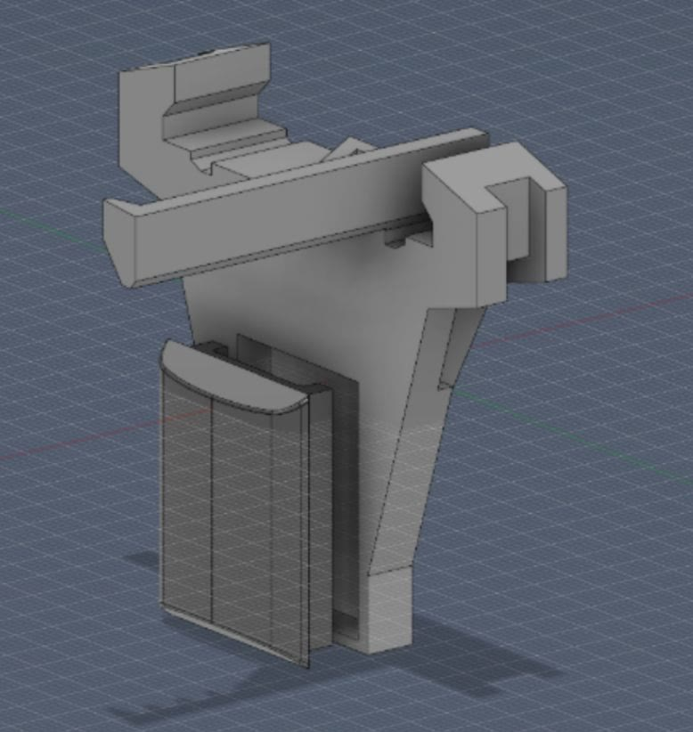</td>
  </tr>
</table>

| Item | Configuration |
| --- | --- |
| Sensor | Paxini GEN3 M3025-series distributed tactile sensor × 2 |
| Placement | Parallel gripper ring / pinky contact surfaces |
| Spatial elements | 77 taxels per sensor, **154 total** |
| Stored tensor | `(2, 9, 9)` `float32` with corner padding |
| Signal used | Z-axis normal-force channel |
| Interface | Paxini high-speed board → UART at **921,600 baud** → background reader |

각 프레임의 원시 154차원 신호는 센서의 공간 배치를 유지한 `(2, 9, 9)` 맵으로 변환됩니다. 따라서 모델은 단순 접촉 여부뿐 아니라 **접촉 위치와 압력 분포**까지 함께 학습할 수 있습니다.

## Architecture

<p align="center">
  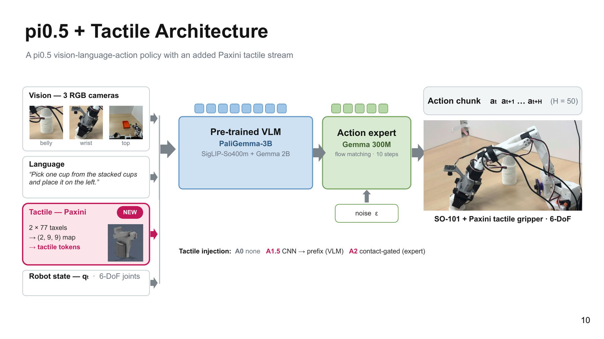
</p>

<p align="center"><sub>Vision · language · tactile map · robot state → pi0.5 → 50-step action chunk. 슬라이드의 A1.5 표기는 저장소 실험명 A15에 해당합니다.</sub></p>

VTLA는 세 가지 촉각 주입 방식을 같은 데이터와 학습 조건에서 비교합니다.

| Variant | Tactile injection | Description |
| --- | --- | --- |
| **A0** | `none` | 촉각을 사용하지 않는 vision-language-action baseline |
| **A15** | `prefix` | CNN tactile encoder 출력을 PaliGemma prefix token으로 삽입 |
| **A2** | `action_gated` | 접촉 통계로 Gemma action expert의 conditioning을 gating |

<details>
<summary><strong>Detailed model architecture</strong></summary>

<br>

<p align="center">
  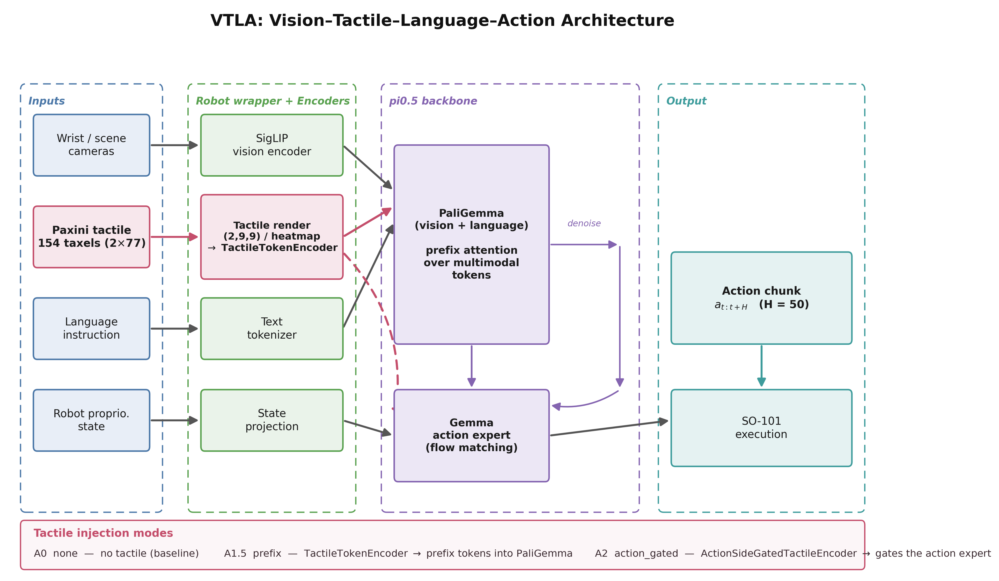
</p>

</details>

<details>
<summary><strong>End-to-end pipeline</strong></summary>

<br>

<p align="center">
  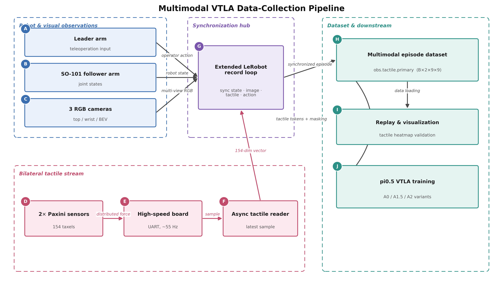
</p>

</details>

## Hardware & data

실험 데이터는 SO-101 follower, Paxini dual tactile sensor, 3개 RGB 카메라로 수집했습니다.

| Dataset snapshot | Value |
| --- | ---: |
| Task | Pick one cup from the stacked cups and place it on the left side |
| Episodes | **60** |
| Frames | **36,625** |
| Sampling rate | **30 FPS** |
| RGB cameras | **3 × 1280 × 720**, AV1 |
| Tactile | **154 taxels → `(2, 9, 9)`**, `float32` |
| Robot state | **6 DoF**, `float32` |
| Action | **6 DoF × 50-step chunk**, `float32` |

### Dataset features

```text
observation.images.top       video [720, 1280, 3]
observation.images.wrist     video [720, 1280, 3]
observation.images.belly     video [720, 1280, 3]
observation.tactile.primary  float32 [2, 9, 9]
observation.state            float32 [6]
action                       float32 [6]
```

원본 MP4, Parquet, checkpoint는 용량 때문에 Git에서 제외합니다. 이 저장소에는 재현 가능한 코드, 메타데이터 구조, 문서, 그리고 README용으로 축약한 시각 자료만 포함합니다.

## Preliminary offline evaluation

실제 로봇에 action을 보내기 전에, 녹화된 episode 0의 408개 frame에서 pi0.5 예측과 demonstration action을 비교했습니다.

<p align="center">
  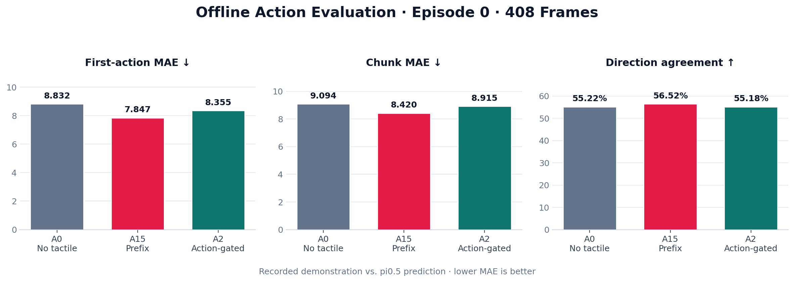
</p>

| Model | First-action MAE ↓ | Chunk MAE ↓ | Direction agreement ↑ | Mean inference |
| --- | ---: | ---: | ---: | ---: |
| A0 · no tactile | 8.832 | 9.094 | 55.22% | 0.191 s |
| **A15 · tactile prefix** | **7.847** | **8.420** | **56.52%** | 0.203 s |
| A2 · action-gated | 8.355 | 8.915 | 55.18% | 0.198 s |

이 단일 episode의 예비 결과에서는 **A15 tactile prefix**가 가장 낮은 action error를 기록했습니다. 이는 제한된 offline 비교이며, 실제 rollout 성공률이나 일반화 성능을 의미하지 않습니다.

<details>
<summary><strong>View A15 joint-wise prediction traces</strong></summary>

<br>

<p align="center">
  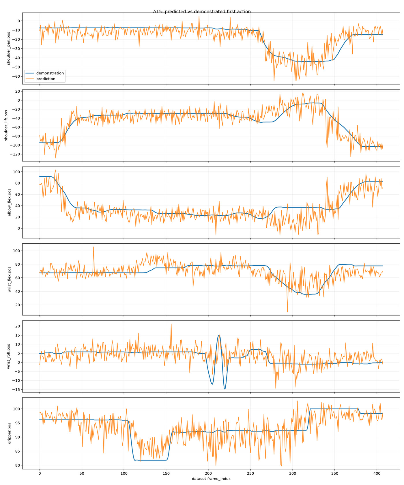
</p>

</details>

## Repository map

```text
VTLA/
├── src/lerobot_robot_paxini/   # Paxini reader, SO-101 wrapper, tactile rendering
├── src/lerobot/policies/
│   ├── tactile/                # Reusable tactile token encoders
│   └── pi05/                   # pi0.5 tactile integration
├── experiments/pi05_cup_left/ # A0 / A15 / A2 PEFT experiment harness
├── user_scripts/               # Server, client, offline evaluation entrypoints
├── local_scripts/              # Recording and dataset utility scripts
└── docs/tactile_pi05/          # Architecture, rollout, and handoff guides
```

## Quick start

### 1. Install

```bash
git clone https://github.com/jhyeong687/VTLA.git
cd VTLA

uv sync --python 3.12 \
  --extra core_scripts \
  --extra paxini \
  --extra pi \
  --extra async \
  --extra peft

source .venv/bin/activate
```

### 2. Verify the pipeline

실제 장비를 연결하기 전에는 mock tactile 입력과 짧은 smoke test로 import, dataset feature, model forward를 먼저 확인하는 것을 권장합니다.

```bash
# Dataset / policy extras included above
lerobot-info

# One-step experiment smoke tests
bash experiments/pi05_cup_left/scripts/run_pi05_experiment.sh A0 1
bash experiments/pi05_cup_left/scripts/run_pi05_experiment.sh A15 1
bash experiments/pi05_cup_left/scripts/run_pi05_experiment.sh A2 1
```

### 3. Offline action comparison

```bash
EPISODE=0 STRIDE=10 MAX_FRAMES=10 \
  bash user_scripts/offline_eval.sh
```

전체 frame 평가:

```bash
EPISODE=0 STRIDE=1 MAX_FRAMES=0 \
  bash user_scripts/offline_eval.sh
```

## Documentation

- [pi0.5 + Paxini rollout guide](./docs/tactile_pi05/README.md)
- [Architecture reference](./docs/tactile_pi05/ARCHITECTURE.md)
- [Offline evaluation handoff](./docs/tactile_pi05/OFFLINE_EVAL_HANDOFF.md)
- [A0 / A15 / A2 training experiments](./experiments/pi05_cup_left/README.md)
- [Paxini + pi0.5 Korean guide](./src/lerobot_robot_paxini/PAXINI_PI05_GUIDE.ko.md)

## Project status

VTLA는 실제 하드웨어 연구를 위한 **research prototype**입니다. 센서 포트, calibration, taxel scale, camera mapping, checkpoint 경로는 장비 및 실행 환경에 맞게 검증해야 합니다. 실제 로봇 rollout 전에는 emergency stop과 joint limit을 확인하고 offline evaluation을 먼저 수행하세요.

## Acknowledgements

이 프로젝트는 Hugging Face의 [LeRobot](https://github.com/huggingface/lerobot) 위에 구축되었습니다. upstream 저작권 고지와 Apache 2.0 라이선스를 유지합니다. pi0.5 및 LeRobot 생태계의 연구·오픈소스 기여자들에게 감사드립니다.

## License

[Apache License 2.0](./LICENSE)
